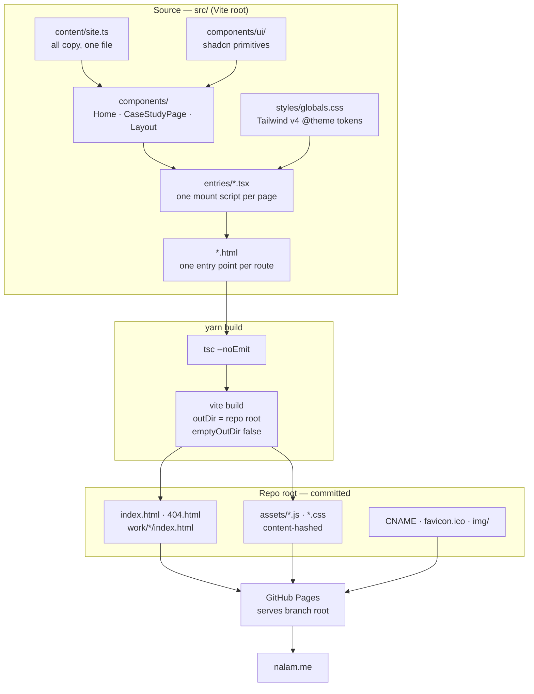
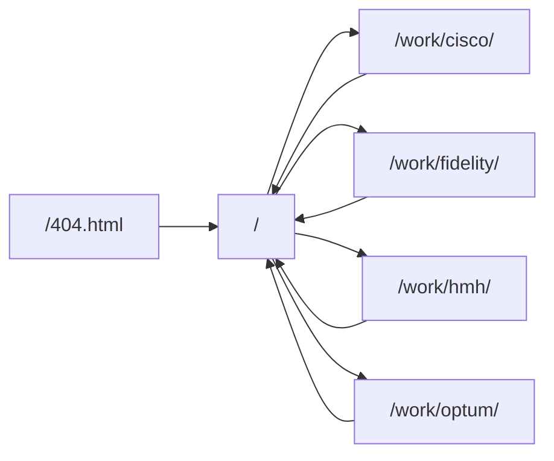
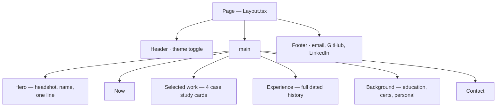

# nalam.me

Personal site of [Nazmul Alam](https://nalam.me) — senior software engineer, Galway.
Static site built with **Vite + React + Tailwind v4 + shadcn/ui**, deployed to
**GitHub Pages** on the custom domain **`nalam.me`**.

## For Cursor / AI agents

Read **`AGENTS.md`** first for conventions and constraints, then **`CONTEXT.md`** for
domain vocabulary. Architectural decisions and their reasoning live in
**`docs/adr/`**. Cursor rules are in **`.cursor/rules/`**.

## Architecture



### Routes

Each route is a **real HTML file**, not a client-side route. Deep links resolve as
static files, so no `404.html` redirect hack is needed and `404.html` stays a genuine
error page.



| Route | Source HTML | Mount script | Component |
|-------|-------------|--------------|-----------|
| `/` | `src/index.html` | `src/entries/home.tsx` | `Home` |
| `/work/cisco/` | `src/work/cisco/index.html` | `src/entries/cisco.tsx` | `CaseStudyPage` |
| `/work/fidelity/` | `src/work/fidelity/index.html` | `src/entries/fidelity.tsx` | `CaseStudyPage` |
| `/work/hmh/` | `src/work/hmh/index.html` | `src/entries/hmh.tsx` | `CaseStudyPage` |
| `/work/optum/` | `src/work/optum/index.html` | `src/entries/optum.tsx` | `CaseStudyPage` |
| `404.html` | `src/404.html` | `src/entries/not-found.tsx` | inline |

Adding a route means all three: a new `src/<path>/index.html`, a matching
`src/entries/<name>.tsx`, and an entry in `rollupOptions.input` in `vite.config.ts`.

### Page composition



## Repository layout

```
naz-mul.github.io/
├── src/                      # Vite root — ALL source lives here
│   ├── index.html            # / entry point
│   ├── 404.html              # error page entry point
│   ├── work/<client>/index.html
│   ├── entries/*.tsx         # one createRoot mount per page
│   ├── components/
│   │   ├── Home.tsx          # home page sections
│   │   ├── CaseStudyPage.tsx # shared case study template
│   │   ├── Layout.tsx        # Page, Header, Footer, Section
│   │   ├── ThemeToggle.tsx
│   │   ├── theme.ts          # light/dark resolution + persistence
│   │   └── ui/               # shadcn primitives (generated)
│   ├── content/site.ts       # ← ALL copy: bio, experience, case studies
│   ├── styles/globals.css    # Tailwind v4 tokens, @font-face, base layer
│   ├── lib/utils.ts          # cn() helper
│   └── public/               # dev-only mirror of root static files
│       └── fonts/            # self-hosted variable woff2
│
├── index.html                # ─┐
├── 404.html                  #  │ BUILD OUTPUT — generated, committed,
├── work/<client>/index.html  #  │ served by GitHub Pages. Do not hand-edit.
├── assets/                   # ─┘
│
├── CNAME                     # nalam.me
├── favicon.ico
├── img/profile.jpg           # headshot, 512×512
├── fonts/                    # generated by `yarn sync:static` from src/public/fonts/
│
├── CONTEXT.md                # domain vocabulary
├── docs/
│   ├── adr/                  # architectural decision records
│   ├── agents/               # issue tracker, triage labels, domain doc rules
│   └── resume/               # GITIGNORED — private, never published
│
├── scripts/check-contrast.py # WCAG AA + sRGB gamut check
├── vite.config.ts
├── tsconfig.json
├── components.json           # shadcn CLI config
├── AGENTS.md
└── README.md
```

> **The repo root holds both source and build output.** Anything at the root matching
> the output list above is generated — edit `src/`, then rebuild.

## Prerequisites

- **Node.js** ≥ 20
- **Yarn 4** — npm is intentionally blocked (`engines.npm: please-use-yarn`)

## Development

```bash
yarn install     # install dependencies
yarn dev         # Vite dev server → http://localhost:3000
yarn build       # typecheck, then build to the repo root
yarn preview     # serve the built output → http://localhost:4173
yarn typecheck   # tsc --noEmit
yarn check:contrast  # WCAG AA + sRGB gamut audit of the palette
yarn verify      # typecheck + contrast
```

`yarn build` chains `yarn clean` (clears `assets/` so stale content-hashed bundles do
not accumulate) and `yarn sync:static` (copies the self-hosted fonts into the shipped
`fonts/`) before typechecking and building.

> **Yarn 4 does not auto-run `pre`/`post` scripts** for custom names. These steps live
> inside `build` deliberately — a `prebuild` hook is silently skipped.

### VS Code / Cursor

| Action | How |
|--------|-----|
| **Run and Debug** | "Open nalam.me (Vite dev)" — starts the dev server, opens Chrome |
| **Preview built output** | "Open nalam.me (built preview)" |
| **Tasks** | `Terminal → Run Task` → `dev: Vite` (default build task) |

## Styling

Tailwind v4, **CSS-first** — there is no `tailwind.config.js`. Design tokens are CSS
custom properties in `src/styles/globals.css`, exposed to Tailwind through `@theme
inline`.

| Token group | Where |
|-------------|-------|
| Light palette | `:root` |
| Dark palette (OS) | `@media (prefers-color-scheme: dark) { :root:not(.light) }` |
| Dark palette (explicit) | `:root.dark` |
| Tailwind mapping | `@theme inline` |

### Theme: light / dark / system

Tri-state, defaulting to **system**. System is implemented in **CSS, not JavaScript** —
no class on `<html>` means "follow the OS", so an OS theme change applies instantly with
no listener and the site still themes correctly with JavaScript disabled. `.light` and
`.dark` are explicit overrides; a `:not(.light)` guard lets an explicit light choice beat
a dark OS. A two-line inline script restores an explicit choice before first paint.

The dark palette is declared twice — once under the media query, once under `.dark`.
Plain CSS cannot share a block between them, so **keep the two in sync.**

### Type

Three self-hosted variable typefaces, each with one job:

| Face | Role | File |
|------|------|------|
| **Newsreader** | display + long-form prose | `newsreader-var.woff2` (+ italic) |
| **Geist Sans** | UI, navigation, lists | `geist-sans-var.woff2` |
| **Geist Mono** | labels, metadata, numbers | `geist-mono-var.woff2` |

~171 KB total, served from `/fonts/`. **Never swap these for a Google Fonts `<link>`** —
that would break the zero-third-party-request rule.

### Colour

OKLCH throughout. The values are load-bearing: every foreground clears WCAG AA (4.5:1)
against the surface it sits on, and every colour is inside the sRGB gamut.

```bash
yarn check:contrast
```

verifies both, in both themes, straight from the CSS. Run it after changing any colour.

shadcn components are generated into `src/components/ui/`:

```bash
yarn dlx shadcn@latest add <component>
```

## Content

**All copy lives in `src/content/site.ts`.** Components render it; they do not contain
prose. To change the bio, a job entry, or a case study, edit that one file.

Content rules that came out of the design process — see `docs/adr/0005-sanitised-case-studies.md`:

- Case studies **name clients but genericise their systems**. No internal architecture,
  no proprietary identifiers, no unpublishable metrics.
- **Never invent metrics.** Figures on the site (7s→2s, 5min→1.5min) come from the CV.
- Voice is direct, specific, first person. No emoji, no skill bars, no logo walls.

## Privacy

`docs/resume/` is **gitignored and must stay that way**. The site is served from the
repo root, so committing it would publish the CV — phone number included — at a public
URL.

## Deployment

GitHub Pages serves the default branch root of `naz-mul.github.io`. There is no Actions
workflow: **the build output is committed**.

```bash
yarn build
git add -A
git commit -m "..."
git push
```

`CNAME` is never touched by the build (`emptyOutDir: false`), so the custom domain
cannot be lost by a deploy.

## Known limitation

Pages are **client-rendered**: the served HTML is a shell around `<div id="root">`, and
the prose lives in the JS bundle. Metadata is static (`<title>`, `og:` tags, JSON-LD),
so link previews and social cards work, and Google executes JS so indexing works. But a
client that does not run JS sees an empty page.

The fix is build-time prerendering with `react-dom/server`, keeping React for
hydration. See `docs/adr/0006-client-rendered-html.md`.

## License

MIT — see `package.json`.
