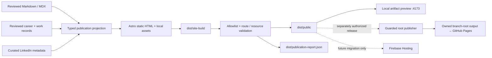
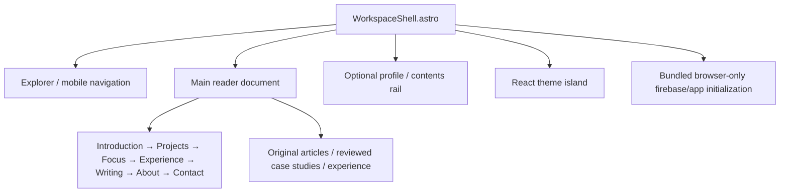

# nalam.me

Nazmul Alam's professional site: engineering work, current technical focus,
experience and original writing. The selected Developer Workspace design uses an
explorer, README canvas and quiet technical-reading pages with self-hosted Geist
Sans and Geist Mono.

**Current implementation:** Astro generates static HTML into disposable staging;
small React islands handle actual interaction. **Current hosting:** GitHub Pages
still serves the incumbent committed branch-root files at [nalam.me](https://nalam.me).
Building and previewing the new implementation do not replace those files or
change the live site. Release is a separate authorized operation.

## Architecture



The common `getPublication()` projection supplies eligible route identities,
metadata, writing, featured work and export requirements. A record needs
`publicationState: published`, `visibility: public` and `reviewed: true` to join
that view. Work maturity and research maturity remain independent.

The eight established indexable URLs are preserved; `/writing/` is the ninth.
A useful `/404.html` is generated separately, marked `noindex` and excluded from
the sitemap. Routes are ordinary static documents with complete main text,
canonical/Open Graph metadata and real links before JavaScript runs. There is no
client router, production render server or catch-all SPA rewrite.



The editor appearance comes from semantic HTML and CSS. Readers do not need
terminal commands, a simulated editor, hover or animation to access the content.
At small widths navigation becomes a native disclosure and the document becomes
a single reading column. Article contents remain ordinary fragment links.

## Repository boundaries

| Location | Meaning |
|----------|---------|
| `src/pages/` | Astro route generation and build-only manifest endpoint |
| `src/components/workspace/` | Shared shell, explorer, profile rail and React theme control |
| `src/components/reading/` | Static article, case-study, experience and writing-index readers |
| `src/content/articles/` | Reviewed-public Markdown/MDX; both existing technical notes retain their URLs |
| `src/content/site.ts` | Reviewed identity, career and bounded client contribution records |
| `src/content/showcase.ts` | Curated featured work and external metadata inputs |
| `src/content/publication.ts` | Strict schema, eligibility, canonical/reference/link/asset rules |
| `src/content/publicationData.ts` | Build-time projection and legacy URL adaptation |
| `src/content/routes.ts` | Preserved legacy route identities and metadata compatibility |
| `src/content/routePages.ts` | Experience copy and retained incumbent note compatibility |
| `src/styles/workspace.css`, `reading.css` | Current visual system and technical prose |
| `src/styles/globals.css` | Retained incumbent Vite fonts/tokens; outside the Astro dependency graph |
| `src/public/` | Self-hosted fonts and reviewed public resource inputs |
| `src/lib/firebase/` | Exact supplied public app config and guarded browser lifecycle |
| `scripts/publication/` | Artifact validation, exact ownership and transactional recovery |
| `dist/site-build/` | Disposable raw generator output; includes a tooling manifest |
| `dist/public/` | Validated public artifact; the only directory the preview server exposes |
| `dist/publication-report.json` | Tooling report and artifact identities; excluded from the public artifact |
| `dist/verification/` | Local browser results and failure traces |
| `.private-drafts/`, `.private-preview/` | Ignored local authoring and disposable previews |
| Root HTML, `assets/`, `sitemap.xml` | Incumbent branch-root publication until an authorized replacement |
| Root `CNAME`, `.nojekyll`, `favicon.ico`, `img/`, `fonts/` | Protected/static resources or reviewed existing assets; not a deletion scope |

`dist/` is ignored. The public artifact excludes source, documentation, tests,
configuration, drafts, workflow mocks, source maps and dependencies. The
build-only `/publication-manifest.json` and sitemap-plugin intermediate files
are excluded; the established `/sitemap.xml` is projected from eligible routes.

A public repository does not provide private draft storage. Even a filtered-out
Markdown record is public if committed. Keep private drafts local and ignored;
promote only reviewed, publishable content into tracked source.
`docs/resume/` remains ignored and must never be included in a commit or artifact.

## Toolchain and commands

Use **Node 24.16.0** and **Yarn 4.17.0**. `.node-version`, `.nvmrc`, `package.json`
and `yarn.lock` hold the exact supported baseline. npm is intentionally blocked.
Direct framework pins are Astro 7.3.8, React 19.2.8, React integration 7.0.1,
MDX integration 8.0.3, sitemap integration 3.7.4, Tailwind 4.3.3 and TypeScript
5.9.3. Ordinary fenced code uses Astro's built-in build-time highlighting;
there is no additional client highlighter, CMS or application backend.

```sh
yarn install
yarn dev               # Astro → http://127.0.0.1:3000
yarn check             # Astro diagnostics and TypeScript
yarn verify            # check, measured contrast/gamut and focused unit/fixture tests
yarn build             # verify → static generation → validated artifact + local Hosting CSP hashes
yarn preview           # only dist/public → http://127.0.0.1:4173
yarn test:e2e          # built-artifact Chromium checks; starts its own preview server
yarn publish:root      # root-publication dry-run; no root output writes
```

Stop an existing preview before `yarn test:e2e`; the suite deliberately refuses to
reuse a listener. Focused scripts include `test:content`, `test:firebase`,
`test:publication`, `test:preview-server`, `test:contrast` and `check:contrast`.
Browser details and limits are in [tests/e2e/README.md](tests/e2e/README.md).
Commands describe current tooling; a successful local suite does not establish
complete WCAG conformance, every browser family or live hosting behavior.

All required stages are explicitly chained: Yarn 4 does not automatically run
custom `pre`/`post` hooks. `.yarnrc.yml` contains narrow released-manifest repairs
for Astro's checker dependencies; see [the publication runbook](docs/operations/publication.md#toolchain-notes)
before removing them. Firebase's unused compatibility-package peer warnings are
recorded in [the Firebase boundary](src/lib/firebase/README.md).

The retained `legacy:build`, `prerender`, `clean` and `sync:static` scripts belong
to the incumbent Vite recovery path. They can write or remove branch-root output
and are not part of normal Astro builds. Preserve its `emptyOutDir: false` while
it remains recoverable. Never point Astro at the repository root.

## Authoring and design

Follow [the authoring guide](docs/operations/authoring.md) for new Markdown/MDX,
publication promotion, project detail and curated LinkedIn entries. Original
writing is self-canonical on nalam.me. LinkedIn entries contain reviewed metadata
and a clear **Read on LinkedIn** destination; no body import, embed or automatic
LinkedIn request runs.

The current three featured summaries are **In progress**. Additional detail pages
need reviewed Problem, Your role, Architecture, Challenges, Outcome, Technology
and Links material; a title does not justify fabricated outcomes or placeholder
actions. Existing client case studies keep their original evidence boundaries.
Principal engineer and architect remain career goals.

Tailwind v4 is CSS-first. Current workspace and reader styles use the selected
blue/green palette, strong sans-serif headings/prose and monospace code/metadata.
Newsreader definitions remain in retained legacy CSS; they do not define the
selected workspace typography. Theme preference is system by default: classless
HTML follows the OS in CSS, with explicit `.light` / `.dark` overrides restored
before paint. Keep both dark-token declarations in sync.

All automatic page resources remain same-origin: self-hosted fonts, bundled
modules and local images. Run `yarn check:contrast` after palette changes and
retain keyboard focus, reduced motion and narrow-screen reflow.

## Firebase and release

The supplied `nalam-aa058` app is initialized through the modular `firebase/app`
boundary in the browser only. Repeated/concurrent entry retains the intended
app; initialization failure does not block reading or navigation. No Firebase
product, analytics, remote project/site binding or deployment is enabled by that
initializer. [Boundary details](src/lib/firebase/README.md) describe the exact
lifecycle and configuration evidence without duplicating app values here.

`firebase.json` is a **future classic Hosting configuration** selecting only
`dist/public`. `yarn build` updates its enforceable CSP hashes for the actual
artifact; it does not upload anything. Firebase preview channels are public.
Project/site selection, provider routes, genuine 404 status, cache/header/CSP
behavior and migration rollback require separately authorized live verification.
GitHub Pages remains the current host.

For current-host release or recovery, use [the publication runbook](docs/operations/publication.md).
The publisher defaults to a dry-run, checks exact ownership/identities and saves
transaction backups before an authorized application. Stage only explicitly
reviewed paths; release tooling never commits or pushes. A local replacement,
a Git push and a verified live release are distinct outcomes.

[ADR-0009](docs/adr/0009-astro-staged-publication.md) records the Astro decision;
earlier ADRs retain their historical rationale with current-status pointers.
[CONTEXT.md](CONTEXT.md) defines vocabulary and [AGENTS.md](AGENTS.md) guides agents.

## License

MIT — see `package.json`.
